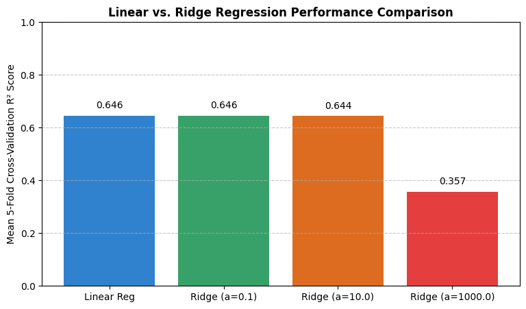

# SC5002 Lab Part 2 – Linear vs. Ridge Regression on California Housing

A small, low-code machine-learning experiment for the **SC5002** lab assignment (Part 2). It predicts median house values in California districts and compares **ordinary least-squares linear regression** with **Ridge regression** across several regularization strengths, using **5-fold cross-validation**.



---

## Contents

| File | Description |
|------|-------------|
| `california_housing_regression.ipynb` | Google Colab notebook with all code and saved outputs |
| `images/model_comparison.png` | Bar chart comparing the cross-validated R² of each model (taken from the notebook output) |

---

## Dataset

The notebook uses the [California Housing dataset](https://scikit-learn.org/stable/modules/generated/sklearn.datasets.fetch_california_housing.html) from scikit-learn, which comes from the 1990 U.S. Census. Each row is one census block group (district).

To keep the experiment quick, **1,000 records are randomly sampled** (`random_state=42`) from the full set of 20,640 rows.

| Feature | Description |
|---------|-------------|
| `MedInc` | Median income in the block group (in tens of thousands of USD) |
| `HouseAge` | Median house age in the block group (years) |
| `AveRooms` | Average number of rooms per household |
| `AveBedrms` | Average number of bedrooms per household |
| `Population` | Block group population |
| `AveOccup` | Average number of household members |
| `Latitude` | Block group latitude |
| `Longitude` | Block group longitude |
| **`MedHouseVal`** (target) | Median house value (in hundreds of thousands of USD; capped at 5.0) |

Sample of the data used:

| MedInc | HouseAge | AveRooms | AveBedrms | Population | AveOccup | Latitude | Longitude | MedHouseVal |
|-------:|---------:|---------:|----------:|-----------:|---------:|---------:|----------:|------------:|
| 1.6812 | 25.0 | 4.192 | 1.022 | 1392 | 3.877 | 36.06 | -119.01 | 0.477 |
| 2.5313 | 30.0 | 5.039 | 1.193 | 1565 | 2.680 | 35.14 | -119.46 | 0.458 |
| 3.4801 | 52.0 | 3.977 | 1.186 | 1310 | 1.360 | 37.80 | -122.44 | 5.000 |
| 5.7376 | 17.0 | 6.164 | 1.020 | 1705 | 3.444 | 34.28 | -118.72 | 2.186 |
| 3.7250 | 34.0 | 5.493 | 1.028 | 1063 | 2.484 | 36.62 | -121.93 | 2.780 |

---

## Method

The notebook follows three tasks.

### Task 2.1: Dataset setup
1. Load the dataset as a pandas DataFrame and sample 1,000 rows.
2. Split it into features `X` (8 columns) and target `y` (`MedHouseVal`).
3. Standardize all features with `StandardScaler` (zero mean, unit variance). Ridge needs this because its penalty treats every coefficient the same, so features must be on comparable scales.
4. Split into **80% train / 20% test** (`random_state=42`).

### Task 2.2: Model training and cross-validation
Each model is scored with **5-fold cross-validation on the training set**, using **R²** (coefficient of determination) as the metric:

- **Linear Regression**: ordinary least squares, no regularization.
- **Ridge Regression**: L2-regularized linear regression, tested with `alpha ∈ {0.1, 10.0, 1000.0}`.

Ridge minimizes

$$
\|y - X\beta\|_2^2 + \alpha \|\beta\|_2^2
$$

so a larger `alpha` pushes the coefficients harder toward zero.

### Task 2.3: Visualization
A bar chart shows the mean cross-validated R² for all four models side by side.

---

## Results

| Model | Mean 5-Fold CV R² |
|-------|------------------:|
| Linear Regression | **0.6457** |
| Ridge (α = 0.1) | **0.6457** |
| Ridge (α = 10.0) | 0.6443 |
| Ridge (α = 1000.0) | 0.3574 |

### Interpretation

- **Linear regression explains about 65% of the variance** in median house value. That is reasonable for a purely linear model on this data; much of the remaining error comes from non-linear effects such as location clusters and the price cap at 5.0.
- **Small regularization (α = 0.1) changes nothing.** The penalty is tiny compared with the data-fit term, so Ridge ends up with almost exactly the OLS coefficients.
- **Moderate regularization (α = 10) costs very little** (−0.0014 R²). With only 8 standardized features and 800 training rows, the OLS model is not overfitting much, so shrinking the coefficients gives no gain.
- **Strong regularization (α = 1000) clearly underfits.** R² drops to about 0.36 because the coefficients are shrunk so far that the model can no longer capture real relationships, especially the strong effect of `MedInc`. This is the **bias–variance trade-off**: too much regularization adds bias faster than it removes variance.

**Conclusion:** on this low-dimensional, well-conditioned problem, plain linear regression (or Ridge with a small α) works best. Regularization would matter more with many correlated features or far fewer samples.

> **Note:** the 20% test split is held out but never evaluated in the notebook. All reported scores are cross-validation scores on the training data.

---

## How to run

### Google Colab (recommended)
1. Open [Google Colab](https://colab.research.google.com/) and choose **File → Upload notebook**.
2. Upload `california_housing_regression.ipynb`.
3. Run the cells in order (**Runtime → Run all**).

### Locally
```bash
git clone https://github.com/ltminh128/-sc5002_labassingment1.git
cd ./-sc5002_labassingment1
pip install numpy pandas matplotlib scikit-learn jupyter
jupyter notebook california_housing_regression.ipynb
```

The dataset is downloaded automatically by `fetch_california_housing` the first time the notebook runs, so an internet connection is needed.

---

## Requirements

- Python 3.8+
- numpy
- pandas
- matplotlib
- scikit-learn

---

## Possible extensions

- Evaluate the final model on the held-out 20% test set.
- Tune `alpha` over a finer, logarithmic grid with `RidgeCV` or `GridSearchCV`.
- Fit the scaler inside a `Pipeline` so it is fitted only on the training folds, which avoids a small amount of data leakage.
- Try Lasso or ElasticNet, or non-linear models such as random forests and gradient boosting.
- Use the full 20,640-row dataset instead of the 1,000-row sample.
